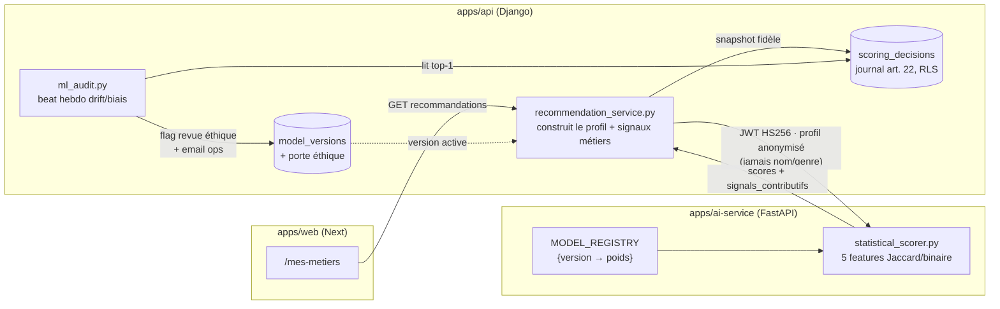
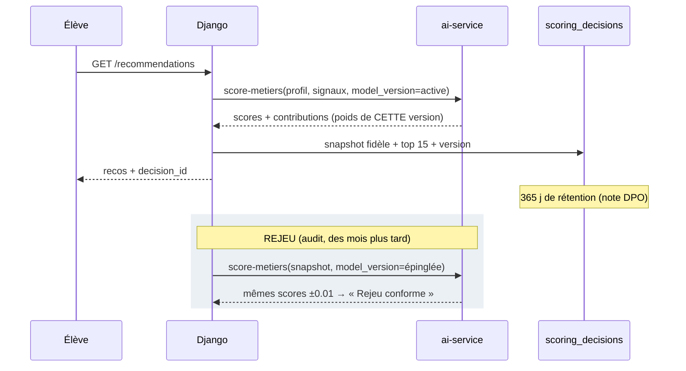
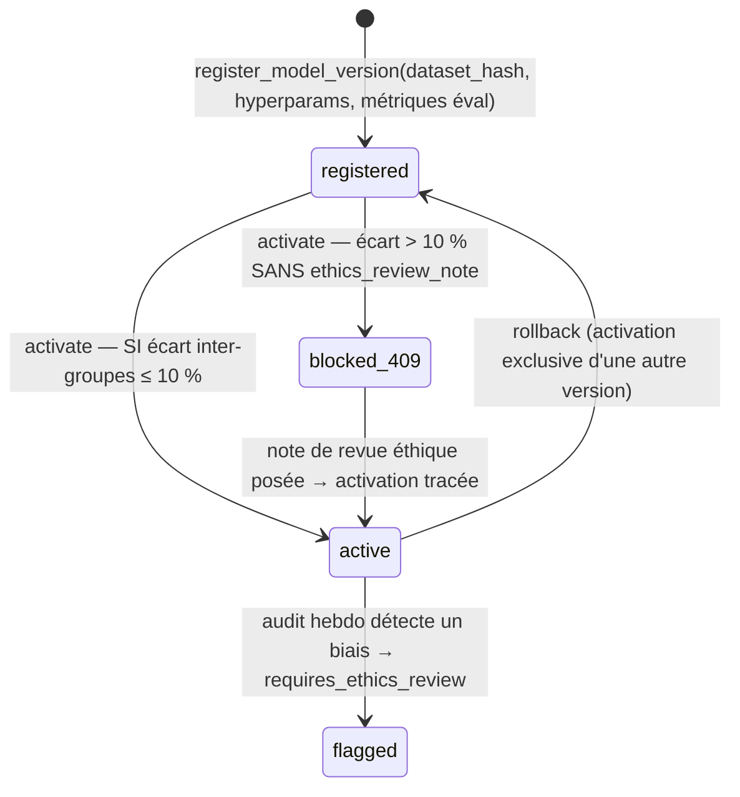
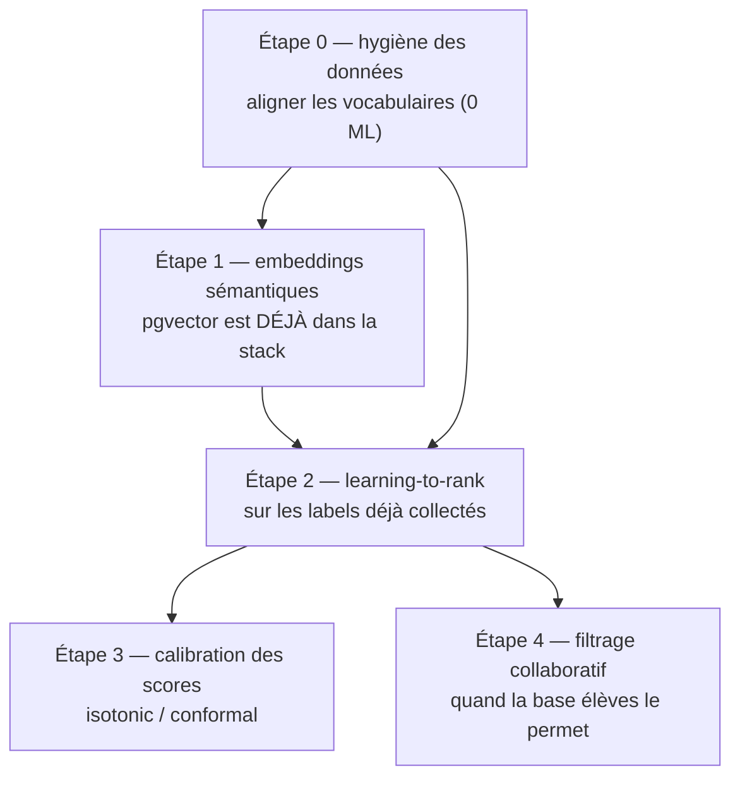

# La partie ML de Path-Advisor — fonctionnement, exemple chiffré, pistes d'évolution

> État au 27/09/2026 (epics 1-10 clos). Fichiers de référence :
> [`statistical_scorer.py`](../apps/ai-service/src/domain/recommendation/statistical_scorer.py) ·
> [`recommendation_service.py`](../apps/api/apps/recommendations/services/recommendation_service.py) ·
> [`models_versioning.py`](../apps/api/apps/recommendations/models_versioning.py) ·
> [`model_governance.py`](../apps/api/apps/recommendations/model_governance.py) ·
> [`ml_audit.py`](../apps/api/apps/recommendations/ml_audit.py)

---

## 1. Vue d'ensemble

Honnêteté d'abord : **le « modèle » actuel n'est pas du ML entraîné**. C'est un
scoreur content-based à 5 features pondérées (`0.3.0-statistical`), dont le
`dataset_hash` seed dit littéralement `"unversioned-legacy"`. Mais toute la
**gouvernance** (versioning, journal art. 22 rejouable, porte éthique, audit
drift/biais) a été construite comme si c'était un vrai modèle — pour que le
jour où un modèle entraîné le remplace, l'infrastructure de conformité soit
déjà là. C'est le point le plus important de ce document : **les idées de la
section 5 se branchent dans des rails existants**, pas dans le vide.



Trois propriétés par construction, non négociables (l'app sert des mineurs) :

- **Le profil envoyé au scoreur ne contient ni nom, ni genre, ni IP** — le
  modèle User n'a pas ces champs, donc aucun modèle futur ne peut les
  apprendre « par accident ».
- **Chaque décision est rejouable** (art. 22) : le snapshot embarque le
  profil ET la tranche du référentiel au moment T.
- **Un modèle biaisé ne peut pas s'activer sans trace écrite** (porte
  éthique, §4).

---

## 2. Le scoreur `0.3.0-statistical`

Cinq features, somme pondérée, un seul arrondi final :

| Feature | Poids | Calcul | Source élève | Source métier |
|---|---|---|---|---|
| `passion_overlap` | 30 % | Jaccard | `StudentProfile.passions` | `signals_json.passions` |
| `valeur_alignment` | 20 % | Jaccard | `StudentProfile.valeurs` | `signals_json.valeurs` |
| `bulletin_quality` | 20 % | moyenne/20 (0 sans bulletin, 0.5 si moyenne absente) | `BulletinManual` | — |
| `niveau_compatibility` | 15 % | binaire ∈ | `StudentLevelProfile.level` | `level_compatibility` |
| `specialite_overlap` | 15 % | Jaccard | `StudentLevelProfile.specialites` | `signals_json.specialites` |

```
score = round( Σ feature_i × poids_i × 100 )   — borné [0, 100]
```

Jaccard normalisé (minuscules, trim) : `|A ∩ B| / |A ∪ B|`. Le `round` unique
sur la somme (et pas par contribution) évite les divergences d'arrondi — une
leçon de revue (C1).

### 2.1 Exemple chiffré, calculé à la main

**Sarah**, terminale générale : passions `{tech-code, jeux-video,
sciences-nature}`, valeurs `{autonomie, creativite}`, spécialités
`{nsi, mathematiques}`, moyenne de bulletins **14,2/20**.

**Métier A — Développeur·se web** : signaux passions `{tech-code, jeux-video,
creation}`, valeurs `{autonomie, creativite, flexibilite}`, spécialités
`{nsi, mathematiques}`, compatible `[lycee_terminale, postbac]`.

| Feature | Calcul | Valeur | × poids × 100 |
|---|---|---|---|
| passions | ∩=2 (`tech-code`,`jeux-video`), ∪=4 | 0,50 | **15,0** |
| valeurs | ∩=2, ∪=3 | 0,667 | **13,3** |
| niveau | `lycee_terminale` ∈ compat | 1 | **15,0** |
| spécialités | ∩=2, ∪=2 | 1,00 | **15,0** |
| bulletins | 14,2 / 20 | 0,71 | **14,2** |
| **Total** | | | **72,5 → 73/100** |

**Métier B — Infirmier·ère** : passions `{aider-autres, sante-soin,
sciences-nature}`, valeurs `{utilite-sociale, stabilite}`, spécialités
`{svt, physique-chimie}`.

| Feature | Calcul | × poids × 100 |
|---|---|---|
| passions | ∩=1 (`sciences-nature`), ∪=5 → 0,20 | **6,0** |
| valeurs | ∩=0 | **0** |
| niveau | 1 | **15,0** |
| spécialités | ∩=0 | **0** |
| bulletins | 0,71 | **14,2** |
| **Total** | | **35,2 → 35/100** |

Le classement (73 vs 35) est **entièrement attribuable** : chaque point vient
d'une feature nommée, renvoyée dans `signals_contributifs` — l'explicabilité
art. 22 (story 3.6) est native, pas reconstruite après coup. Le
`confidence_level` de Sarah est `high` (bulletins présents, moyenne ≥ 14) ;
sans bulletins il serait `low` et l'UI le dit (story 3.10).

### 2.2 Les limites connues de ce scoreur (consignées au fil des stories)

1. **Vocabulaires désalignés** — la plus grosse. L'onboarding produit des
   slugs fermés (`aider-autres`, `sante-soin` ; 20 passions, 13 spécialités
   GT) mais les `signals_json` seedés contiennent du texte libre
   (`"aider les autres"`, `"médecine"`, `"biologie"`). Un Jaccard exact ne
   matche pas `aider-autres` ↔ `aider les autres` : **des affinités réelles
   comptent zéro**. (Découvert en 10.1 en construisant la table d'affinité.)
2. **`niveau` binaire** : être « compatible » ne dit rien du niveau d'effort.
3. **`bulletin_quality` fruste** : moyenne de toutes les notes de tous les
   trimestres — pas de pondération matière↔métier (des maths faibles pèsent
   autant pour Infirmière que pour Data engineer), pas de tendance.
4. **Aucun apprentissage** : les poids (30/20/20/15/15) sont éditoriaux.
   Or le produit **collecte déjà des labels** : favoris « Mes paris » (4.8),
   demandes de revue humaine (3.7), envois anticipés (5.4), réponses écoles
   (5.7). Personne ne les consomme.
5. **Pas de personnalisation inter-élèves** : deux profils identiques auront
   toujours les mêmes recos (acceptable en MVP, limitant ensuite).

---

## 3. Le journal art. 22 et le rejeu (story 9.5)

Chaque calcul de reco écrit une ligne `ScoringDecision` **dans la même
transaction de lecture**, sous RLS (les vœux d'un mineur sont des données
personnelles) :

```jsonc
// ScoringDecision.inputs_snapshot — FIDÈLE : le référentiel au moment T
{
  "profile": { "passions": ["tech-code", ...], "niveau": "lycee_terminale",
               "specialites": ["nsi", "mathematiques"],
               "has_bulletins": true, "bulletin_summary": {"average": 14.2} },
  "occupation_ids": ["prof_01H...", ...],
  "professions_data": [ { "occupation_id": "prof_01H...",
      "signals_json": {...}, "level_compatibility": [...] }, ... ]
}
// ScoringDecision.top_scores — borné top 15
[ {"id": "prof_01H...", "slug": "developpeur-web", "score": 73}, ... ]
```



Le rejeu (`manage.py replay_scoring_decision <id>`) fonctionne parce que
l'ai-service garde **toutes les versions jamais déployées** dans
`MODEL_REGISTRY` (immuable : on ajoute, on n'édite jamais) et que le snapshot
fige le référentiel — une fiche métier éditée depuis (9.1) ne change pas le
rejeu. Une version inconnue demandée → 422 ; une version répondue inconnue du
back → ligne auto-enregistrée et flaggée.

---

## 4. Gouvernance : cycle de vie d'une version et porte éthique



La **porte éthique** lit `evaluation_metrics_json.subpopulations` AVANT
déploiement. Exemple réel de la preuve live 9.5 :

```jsonc
{ "subpopulations": { "niveau": { "lycee_terminale": 0.72, "postbac": 0.60 } } }
// écart relatif = (0.72 − 0.60) / 0.72 = 16,7 % > 10 % → activation refusée (409)
// jusqu'à ce qu'une ethics_review_note écrite assume la décision.
```

Cadrage important (acté en 9.5/9.6) : les sous-populations sont **niveau et
filière** — jamais le genre, qui n'existe nulle part dans les données par
construction. L'introduire exigerait une décision produit + DPO.

---

## 5. L'audit en production (story 9.6)

Un beat hebdomadaire surveille le **score top-1** (la reco de tête, celle que
l'élève voit vraiment) :

- **Drift** : Kolmogorov-Smirnov deux-échantillons écrit à la main (12 lignes,
  pas de scipy), entre une **baseline gelée** (les 500 premiers top-1 après
  activation) et la fenêtre glissante de 30 j. Seuil `1.36·√((n+m)/nm)`,
  plancher 50 échantillons de chaque côté — en dessous : « insuffisant »,
  jamais d'alerte sur du bruit.
- **Biais** : moyenne du top-1 par niveau/filière (groupes ≥ 30) ; écart
  relatif > 10 % ⇒ version flaggée pour revue éthique + email ops avec le
  workflow (réentraîner ? rollback 9.5 ?).

**La leçon des ex-aequo** (attrapée en preuve live, pas en test) : les scores
sont des entiers 0-100 → paquets massifs d'ex-aequo. Le two-pointer KS naïf
avance d'un seul côté sur un ex-aequo et gonfle D :

```
baseline = [55]*40 + [85]*40 ; courant = identique
naïf   : D ≈ 0.5  → fausse alerte drift sur des données IDENTIQUES
correct: consommer x = min(a[i], b[j]) DES DEUX CÔTÉS avant de mesurer |i/n − j/m|
         → D = 0
```

Épinglé par `test_ks_handles_massive_ties` — le test unitaire initial utilisait
des valeurs toutes distinctes et ne pouvait pas le voir.

---

## 6. Pistes d'évolution — avec de vrais algorithmes

Ordonnées par ratio valeur/risque. Chacune se branche dans les rails
existants : nouvelle entrée `MODEL_REGISTRY`, `register_model_version` avec
`dataset_hash` **réel**, métriques de sous-populations pour la porte éthique,
rejouabilité conservée. Contrainte transverse : public mineur → tout reste
**batch, versionné, explicable** ; pas d'apprentissage en ligne opaque.



### Étape 0 — Hygiène des vocabulaires (prérequis, zéro ML)

Normaliser `signals_json` sur les slugs fermés de l'onboarding (script de
migration éditoriale + validation dans l'admin 9.1). Sans ça, toute feature
lexicale — Jaccard actuel ou embeddings futurs — apprend sur du bruit.
*Effort : faible. Gain immédiat sur le scoreur ACTUEL.*

### Étape 1 — Similarité sémantique par embeddings (le meilleur premier pas)

- **Algo** : encoder passions/valeurs/description élève et fiches métiers avec
  un modèle de phrases multilingue (ex.
  `paraphrase-multilingual-MiniLM-L12-v2`, 384 dims, CPU-friendly), stocker
  les vecteurs métiers dans Postgres — **l'extension pgvector est déjà
  installée** (la lane RLS la provisionne depuis la 1.8). Nouvelle feature
  `semantic_similarity = cosine(v_élève, v_métier)` qui remplace ou complète
  les deux Jaccard lexicaux.
- **Pourquoi c'est le bon premier pas** : ça résout structurellement le
  problème n°1 (`aider-autres` ≈ `"aider les autres"` ≈ `"soin aux personnes"`
  en cosinus), sans données d'apprentissage, et ça reste explicable (« tes
  centres d'intérêt sont proches de ceux du métier » + top-k tokens
  contributifs).
- **Gouvernance** : version `0.4.0-hybrid`, `dataset_hash` = SHA256 du dump
  des embeddings métiers, poids de mélange dans `hyperparameters_json`,
  éval hors-ligne sur les décisions journalisées (le rejeu 9.5 devient un
  **harness d'A/B hors-ligne gratuit** : rejouer N décisions avec la
  nouvelle version et comparer les classements).
- *Effort : moyen. Risque : faible (batch, déterministe).*

### Étape 2 — Learning-to-rank sur les signaux produits

Le produit collecte déjà des **labels implicites** que personne n'exploite :

| Signal | Table | Force du label |
|---|---|---|
| Favori « Mes paris » | `favorite_schools` / paris (4.8) | forte |
| Envoi anticipé payé | `early_outreach_requests` (5.4) | très forte |
| Demande de revue « je ne me reconnais pas » | reviews (3.7) | **négative** forte |
| Clic fiche métier depuis les recos | à instrumenter (privacy-safe : compteur agrégé, pas de trace individuelle) | faible |

- **Algo** : commencer par une **régression logistique** (pointwise —
  P(engagement | features)), features = les 5 actuelles + similarité
  sémantique + croisements simples. Puis **gradient-boosted ranker**
  (LightGBM/XGBoost en objectif `lambdarank`) si le volume suit.
  Éval hors-ligne : **NDCG@10** et rappel@10 en découpe **temporelle**
  (train sur les mois passés, test sur le dernier — jamais de fuite).
- **Explicabilité** : la logistique est nativement lisible (coefficients →
  `signals_contributifs`) ; pour les arbres, **SHAP** par décision, stocké
  dans le journal — l'art. 22 exige de savoir dire *pourquoi ce métier*.
- **Équité dès l'éval** : produire les métriques par niveau/filière AVANT
  activation (c'est exactement le format que la porte éthique consomme) ; y
  ajouter un écart de NDCG inter-groupes, pas seulement de score moyen.
- *Effort : moyen-fort. Risque principal : biais de boucle (on recommande →
  on clique → on apprend le recommandé). Mitigation : conserver une part
  d'exploration déterministe et versionnée (ε fixe documenté dans les
  hyperparams, jamais d'urgence fabriquée côté UI).*

### Étape 3 — Calibration et confiance honnête

Un « 73/100 » actuel est un rang, pas une probabilité. Deux outils :

- **Régression isotonique** (ou Platt) sur les labels de l'étape 2 → le score
  devient interprétable (« parmi les élèves à profil comparable, X % ont
  confirmé cet intérêt »).
- **Prédiction conforme** pour remplacer le `confidence_level` heuristique
  (low/medium/high) par une garantie de couverture : « avec 90 % de
  couverture, ton métier de tête est dans ce top-k ». Très adapté à un
  produit qui refuse de sur-promettre à des ados.
- *Effort : faible une fois l'étape 2 en place.*

### Étape 4 — Filtrage collaboratif (plus tard, volume requis)

**ALS implicite** (matrice élèves × métiers pondérée par la force des
signaux) pour capter « les élèves proches de toi ont exploré… ». Hybride avec
le content-based pour le cold-start (un nouvel élève a toujours l'étape 1).
Prudence spécifique mineurs : les facteurs latents peuvent encoder des
corrélations sensibles non désirées — l'audit 9.6 par sous-populations
devient un **prérequis d'activation**, pas un contrôle a posteriori, et la
porte éthique s'applique telle quelle.
*Effort : fort. Ne pas commencer avant quelques milliers d'élèves actifs.*

### Ce qui ne changera pas, quelle que soit l'étape

- `dataset_hash` réel + hyperparams + métriques dans `register_model_version` ;
- activation **exclusive**, rollback en un geste, rejeu ±0.01 exigé ;
- porte éthique > 10 % inter-groupes avant tout déploiement ;
- ni genre ni attribut sensible dans les features ;
- baseline de drift re-gelée à chaque activation (le KS compare des
  distributions de la MÊME version).

---

## 7. Registre ML (rappel)

- Étape 0 (vocabulaires) : faisable dès maintenant, améliore le scoreur actuel.
- Dimensions d'audit région/type-établissement : attendent une donnée
  élève↔établissement qui n'existe pas encore.
- Slack pour les alertes d'audit : non câblé (aucun webhook en infra).
- Le recalibrage des seuils de drift sur données réelles suit la même logique
  que 8.9-AC5 : re-dû au premier déploiement production.
