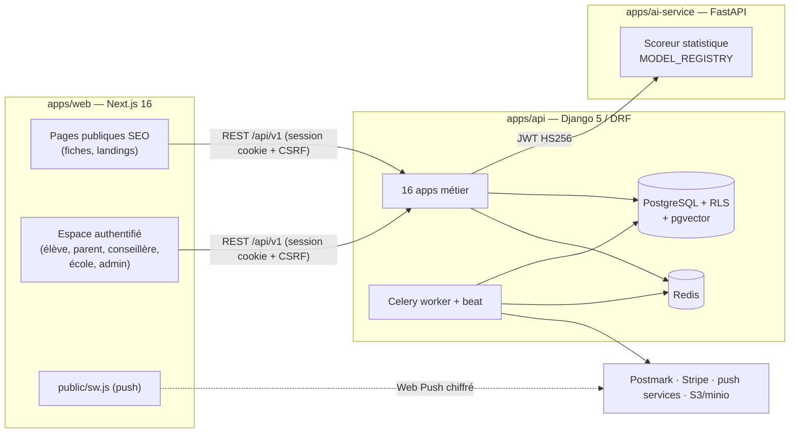

# Guide de la codebase Path-Advisor

> Revue complète au 2026-10-10 (HEAD `fe3bf09`, epics 1-10 clos, 90 stories).
> Ce guide explique **chaque partie du code** : à quoi elle sert, où elle vit,
> et les décisions de conception qui la gouvernent. Il complète
> [`fonctionnement-ml.md`](fonctionnement-ml.md) (le détail ML) et
> [`story-deploiement-production.md`](story-deploiement-production.md) (l'infra cible).

## 0. Vue d'ensemble

Path-Advisor est un monorepo à trois applications + infra :

| Couche | Techno | Rôle |
|---|---|---|
| `apps/web` | Next.js 16, React 19, Tailwind (tokens), next-intl (fr), vitest | Tout le front : SEO public + 6 espaces par rôle |
| `apps/api` | Django 5, DRF, Celery, allauth/dj-rest-auth, django-otp | Métier, auth, données, conformité |
| `apps/ai-service` | FastAPI, pydantic | Scoring vocationnel, versions de modèles servables |
| `infra/` | docker compose (colima en dev) | postgres, redis, mailpit, minio, les 3 apps, worker, beat |
| CI | 4 workflows GitHub Actions | 5 checks requis sur `main` (api, web×2, openapi, lighthouse, rls) |

**Les six rôles** (`UserRole`) : `student`, `parent`, `counselor`,
`school_admin`, `path_admin`, `support` — chaque espace front et chaque
endpoint est gardé par rôle (cf. §1 RBAC).

## 0bis. Les patrons transverses (à lire avant tout le reste)

Ces sept patrons reviennent dans toutes les apps ; les connaître rend le
reste du guide évident.

### 1. RLS Postgres + GUCs de session
Chaque requête HTTP pose trois variables Postgres (`app.current_user_id`,
`app.current_tenant_id`, `app.actor_role`) via `TenantSessionMiddleware` ;
les tables personnelles portent des policies `*_isolation_select/modify` qui
filtrent dessus. Deux échappatoires **nominatives et auditées** dans
`apps/core/rls.py` : `bypass_rls(reason=...)` (liste de 7 call-sites
documentés — flux anonymes par token, beats outreach) et
`with_system_actor(reason=...)` (liste de 12 — beats cross-utilisateurs).
Toute nouvelle tâche Celery touchant des tables RLS DOIT s'y inscrire.
La **lane de tests dédiée** (`pytest -m "rls or postgresql_only"`, Postgres
jetable, rôle `NOSUPERUSER NOBYPASSRLS`) tourne en CI (`rls-tests`) et en
local avant chaque PR.

### 2. RBAC déclaratif + gate CI
`apps/core/permissions.py` : `PathAdvisorPermission` (refus audité
`rbac.access_denied`, flags `requires_mfa_verified` / `requires_fully_active`)
décliné en `IsStudent`, `IsParent`, `IsCounselor`, `IsSchoolAdmin`,
`IsPathAdmin` (seul à avoir le bypass superuser), `IsSupport`, `IsPremium`…
Le script `apps/api/scripts/assert_rbac_declared.py` échoue la CI si un
endpoint n'a pas de permission explicite (325 endpoints au compteur) —
les exceptions vivent dans deux whitelists commentées.

### 3. L'outbox email (8.1) et le moteur de notifications (8.2)
AUCUN email ne part en direct : `send_transactional` écrit une ligne
`email_outbox` (QUEUED) et la délivrance est un task Celery avec claim CAS,
retries exponentiels, re-vérification de l'opt-out au moment de l'envoi, et
footer légal construit AU RENDU (jamais de token persisté). `notify()`
(apps/notifications/services.py) est l'unique entrée pour les emails de
catégorie : porte d'opt-out à l'émission + fan-out push optionnel
(`push={title, body, url}`) enfilé `on_commit`. Six catégories, toutes
désinscriptibles par token signé sans login.

### 4. Statut éditorial → `is_active` dérivé (9.1/9.2)
`Profession.status` et `School.status` (draft/published/archived) sont la
source de vérité ; `is_active` est recalculé dans `save()` pour que les
dizaines de requêtes publiques des epics 3/7 restent intactes. « Supprimer »
= archiver (intégrité référentielle) ; chaque écriture crée une
`*Revision` (snapshot append-only, rollback = nouvelle révision).

### 5. Journal d'audit
`record_audit(action=, result=, actor=, subject_id=, metadata=)` rejoint la
transaction appelante ; les événements sont catalogués dans
`docs/patterns/audit-events.md`. Données minimisées (emails hashés quand il
le faut). Le décorateur `@audit_action` fait pareil pour les services.

### 6. Le ton (produit pour ados)
`apps/notifications/tone.py` (API) et `apps/web/src/lib/i18n/tone.test.ts`
(front) interdisent les marqueurs d'urgence (« vite », « dernière chance »,
« attention », 🎉…) dans TOUTES les chaînes — testé, pas juste une charte.
Corollaires : pas de `first_name` sur User, pas de genre nulle part, push
sûrs pour écran verrouillé.

### 7. Exactly-once des beats
Tout envoi planifié se réclame par **UPDATE conditionnel sur une colonne
d'horodatage** (milestones 8.3, digest 8.5, rappels visio 10.4) — jamais
d'ETA Redis (visibility_timeout 4 h = redélivrance) ni de confiance dans le
scheduler seul.

## Sommaire

- **Partie I — apps Django** : 1 `mailer` · 2 `notifications` · 3 `telemetry`
  · 4 beats Celery · 5 `professions` · 6 `schools` · 7 `students` ·
  8 `bulletins` · 9 `recommendations` · 10 `outreach` · 11 `billing` ·
  12 `family` · 13 `establishments` · 14 `core` · 15 `accounts` · 16 `audit`
  · 17 `profiles`
- **Partie II** — `ai-service` (FastAPI)
- **Partie III** — infra, CI, outillage
- **Partie IV** — `apps/web` (routage, lib, composants-contrats)
- **Partie V** — registre des écarts relevés par la revue + chiffres finaux

---

# Partie I — Les apps Django (`apps/api/apps/`)

## 1. `mailer` — l'outbox email (Story 8.1)

**Rôle** : aucun email ne part en direct ; tout passe par une outbox durable.
Pas de surface API volontairement (les lignes contiennent des adresses de
mineurs et des URLs à jeton) — lecture par ORM/shell uniquement.

| Fichier | Rôle |
|---|---|
| `models.py` | `EmailOutbox` (table `email_outbox`, sans RLS) : `to`, `template_app/base`, `context` JSON sérialisable, `status`, `attempts`, `last_error`, `notification_user_id/category`, `sent_at`. `OutboxStatus` : `queued → sending (claim CAS) → sent / skipped (opt-out à la livraison) / failed (terminal + log ERROR)`. |
| `service.py` | `send_transactional(...)` — point d'entrée unique (remplace 8 helpers dupliqués) : vérifie la sérialisabilité du contexte, crée la ligne, enfile `deliver_email` via `on_commit(robust=True)` (transaction annulée = rien ne part ; broker en panne = le sweeper reprend). |
| `tasks.py` | `deliver_email` (acks_late, 8 retries, backoff 30 s→1 h ≈ 2 h 04 cumulées) : **claim CAS** `QUEUED→SENDING` (couvre double enqueue, redelivery Redis, double retry), re-check opt-out à la livraison (→ SKIPPED), footer légal **construit au rendu** (`manage_notifications_url` + `unsubscribe_url` signée — jamais persistée). `sweep_stale_outbox` (beat 15 min) récupère 3 populations d'orphelines : hook perdu (15 min), ETA de retry perdu (70 min), SENDING crashé (30 min, at-least-once assumé). |
| `retention.py` + commands | purge 90 j des lignes terminales (`prune_email_outbox`, beat 04:40) ; `retry_failed_emails` (rejeu opérateur, remise en file conditionnelle donc sûre à deux). |

Tests : 18. Migrations : 2, sans RLS.

## 2. `notifications` — le moteur de catégories (8.2) + calendrier, digest, recap, push

**Rôle** : la couche « est-ce que cet utilisateur veut recevoir ça » au-dessus
du mailer, plus quatre produits : jalons Parcoursup (8.3), digest nouvelles
écoles (8.5), DeltaRecap (8.6), Web Push (10.2).

### Modèles (`models.py`)
| Modèle | Table | RLS | Essence |
|---|---|---|---|
| `NotificationPreference` | `notification_preferences` | **oui** (0002) | opt-out : l'absence de ligne = activé ; `is_enabled(user_id, category)` |
| `ParcoursupMilestone` | `parcoursup_milestones` | non (public) | `kind` ×5, `campaign`, `date`, `notify_days_before`, `notified_at` = dédup par lot |
| `NewSchoolsDigestRun` | `new_schools_digest_runs` | non | la semaine ISO est l'unité d'exactly-once du digest |
| `DeltaRecapCursor` | `delta_recap_cursors` | **oui** (0006) | `seen_at` bouge seulement à l'ACK (pas `last_login`, qu'allauth écrase au login) |
| `PushSubscription` | `push_subscriptions` | **oui** (0009) | la ligne = le consentement de CET appareil ; `endpoint` unique |

Catégories (`NotificationCategory`, ×6) : `parcoursup_calendar`,
`school_responses`, `new_schools`, `profile_completion` (masquée du GET tant
qu'aucun émetteur n'existe — P2-4, un toggle qui ne pilote rien est
malhonnête), `report_updates` (9.3), `referrals` (10.5).

### `services.py` — `notify()`
Unique voie d'envoi par catégorie. Porte d'opt-out **double** (à l'émission
ici, re-vérifiée à la livraison par `deliver_email`) ; retour `None` =
« pas envoyé parce que l'utilisateur a dit non », à traiter comme un succès.
`push={title, body, url}` optionnel → `send_web_push.delay` via `on_commit`
derrière la même porte. Appelants : outreach (réponses école, entretien),
professions (suivi signalements), accounts (parrainage).

### `views.py` / `urls.py` — 8 routes
| Route | Permission | Notes |
|---|---|---|
| GET/PUT `me/notification-preferences/` | IsAuthenticatedAndActive | PUT accepte tout, GET masque profile_completion |
| POST `notifications/unsubscribe/` | AllowAny + throttle, sans auth | **POST, jamais GET** (les préchargeurs d'emails suivent les GET) ; `bypass_rls` nominal ; idempotent même compte supprimé |
| GET `me/delta-recap/` + POST `ack/` | IsAuthenticatedAndActive | 1er appel = baseline sans cartes ; <24 h = rien ; lire ne déplace JAMAIS le curseur, seul l'ACK le fait |
| GET/POST + PATCH `admin/parcoursup-milestones/` | IsPathAdmin | pas de DELETE ; jalon notifié = date verrouillée (409) ; audité |
| POST/DELETE `me/push-subscriptions/` | IsAuthenticatedAndActive | `update_or_create` sur endpoint (réattribution au changement de compte), DELETE idempotent |
| GET `notifications/push/vapid-public-key/` | IsAuthenticatedAndActive | 204 si non configuré → le front masque le toggle |

### `tasks.py` + `push.py` + `delta_recap.py`
- **Jalons 8.3** : jalon dû si `date − notify_days_before ≤ aujourd'hui ≤ date` ;
  un jalon passé est consommé SANS envoi (log ERROR `milestone_missed` — on
  n'annonce jamais au présent une date passée) ; **claim CAS** du jalon en
  tête de transaction (P0-1 : deux passes parallèles = un seul envoi de
  masse) ; email + push au même ton.
- **Digest 8.5** : fenêtre contiguë depuis le `sent_at` du run précédent
  (un run en retard rattrape l'arriéré), pertinence = recoupement de signaux
  ≥ 2 sans appel IA, max 5 écoles listées.
- **Push 10.2** (`push.py:deliver_web_push`) : best-effort jamais rejoué
  (l'email est le canal durable) ; aes128gcm + VAPID ; 404/410 → purge de
  l'abonnement ; clé privée absente = canal coupé (NFR-R4) ; payloads sûrs
  écran verrouillé.
- **DeltaRecap 8.6** (`delta_recap.py`) : cartes serveur (lintables), 90 j de
  lookback max, stat avant/après seulement si le delta est postérieur au
  curseur (P2-1), carte calendrier dans sa propre fenêtre (P1-4).
- `milestone_copy.py` : source unique des textes des 5 jalons (emails + push
  + cartes). `tone.py` : les regex `URGENCY_MARKERS`/`NOT_ALIGNED_MARKERS`
  du linter de ton (miroir front dans `tone.test.ts`).
- `tokens.py` : jeton de désinscription signé **sans expiration**
  (l'obligation légale n'expire pas).
- `exporters.py` : préférences + curseur + abonnements push dans l'export
  RGPD art. 15/20.
- Commands : `generate_vapid_keys` (paire à copier dans .env — jamais
  commitée), `seed_parcoursup_calendar` (campagne 2026-2027 idempotente).

Tests : 67. Migrations : 10, dont 3 RLS.

## 3. `telemetry` — RUM anonyme des Core Web Vitals (8.9)

**Rôle** : le thermomètre de terrain qui complète les budgets Lighthouse
simulés. **Vie privée par construction du schéma** : `rum_vitals` n'a aucune
colonne user/session/IP/UA/URL — `page_type` est un enum fermé de 5 TYPES de
pages publiques (jamais un slug, qui révélerait un intérêt). Ce que le schéma
ne peut pas stocker ne peut pas fuiter.

| Fichier | Rôle |
|---|---|
| `models.py` | `RumVital` : metric (LCP/CLS/INP/TTFB/FCP), value, rating, page_type, device, connection, created_at. Sans RLS (rien de personnel). |
| `serializers.py` | ingestion stricte anti-parasites : ChoiceField partout, valeur bornée 0-120 000, batch ≤ 10 |
| `views.py` | POST `rum/vitals/` (AllowAny, sans auth NI session — même le beacon d'un élève connecté est anonyme ; throttle 60/min/IP ; réponse 204 car le beacon part sur pagehide) ; GET `admin/rum/summary/` (IsPathAdmin) : p75 rang-le-plus-proche par métrique×page, ventilé device/connexion, fenêtre 28 j (CrUX) max 90 j |
| `tasks.py` + command | purge 90 j (beat 04:45) |

Tests : 13.

## 4. Le planning Celery beat (`path_advisor/celery.py`) — 18 entrées

Deux signaux `task_prerun/postrun` purgent le contexte d'audit thread-local
entre les tâches (un worker réutilisé ne doit pas transmettre l'acteur de la
tâche précédente). Beat tourne en **UTC**.

| Cadence (UTC) | Tâche | Rôle |
|---|---|---|
| 02:45 | `accounts.sweep_account_deletions` | suppression définitive après la grâce 30 j (1.12) |
| 03:00 le 1ᵉʳ | `audit.archive_old_logs` | archivage mensuel des logs d'audit (1.13) |
| 04:00 le 2 | `audit.verify_chain_integrity` | intégrité de la chaîne d'audit (1.13) |
| 04:00 | `accounts.send_parental_consent_reminders` | relances parents (1.4) |
| 04:15 | `accounts.suspend_unresolved_parental_consents` | suspension à J+60 (1.4) |
| hh:20 | `accounts.notify_unconfirmed_granted_consents` | réconciliation email « accordé » perdu (1.4 P14) |
| 04:30 | `gdpr.expire_old_exports` | expiration des exports RGPD (1.11) |
| 04:35 | `family.expire_parent_invitations` | invitations parents > 30 j (6.1) |
| 04:40 | `billing.process_dunning` | relances J+0/3/7 puis downgrade (5.2) |
| 04:40 | `mailer.prune_email_outbox` | rétention 90 j de l'outbox |
| 04:45 | `telemetry.prune_rum_vitals` | rétention 90 j du RUM |
| 04:45 | `outreach.expire_stale_requests` | envois sans réponse école > 7 j (5.6) |
| 04:50 | `recommendations.prune_scoring_decisions` | rétention 365 j du journal art. 22 (9.5) |
| 05:00 dim. | `recommendations.run_ml_audit` | audit ML drift/biais (9.6) |
| 07:00 | `notifications.send_parcoursup_milestone_notifications` | jalons dus (8.3) |
| 08:00 lun. | `notifications.send_new_schools_digest` | digest hebdo (8.5) |
| */15 min | `mailer.sweep_stale_outbox` | outbox orpheline |
| */15 min | `outreach.send_interview_reminders` | rappels visio J-1/H-1 (10.4) |

*Deux micro-dettes relevées par la revue : 04:40 et 04:45 sont doublement
occupés (convention d'étalement non respectée), et le commentaire de
`sweep_account_deletions` dit « 03:45 Paris » pour un cron réellement à
02:45 UTC.*

## 5. `professions` — le référentiel métiers (3.2, 3.8, 9.1, 9.3, 10.3)

**Rôle** : les ~52 fiches métiers curées (cible 500 en growth), les
signalements d'erreur des élèves et l'historique éditorial. Donnée publique
→ pas de RLS (choix explicite).

### Modèles
| Modèle | Essence |
|---|---|
| `Profession` (pk `prof_…`) | `slug`, `name`, `description` (rédigée pour 15-18 ans), `daily_routine` (récit à la 2ᵉ personne), `requirements_json`, `signals_json` `{passions, valeurs, specialites, keywords}` (consommé par le scoring), `level_compatibility` (JSONField, pas ArrayField — SQLite de la fast lane), `median_salary_eur`, `status` éditorial → `is_active` forcé dans `save()` |
| `ProfessionReport` (3.8) | `error_type` ×4, `status` : pending/resolved/dismissed/**info_requested** (reste en file), `admin_note`/`handled_by`/`handled_at` (9.3) |
| `ProfessionRevision` (9.1) | snapshot JSON post-écriture, `action` (created/updated/status_changed/rolled_back), `restored_from` — « l'historique ne se réécrit jamais » |

### Services
- `services/referential_admin.py` : **unique point d'écriture admin** — trois
  invariants par transaction : révision + audit + sync `status→is_active`.
  Pas de delete (un métier est référencé par parcours/signalements/envois →
  archiver). `EDITORIAL_FIELDS` = le périmètre des snapshots/rollbacks.
- `services/report_moderation.py` (9.3) : `resolve` (notifie l'élève,
  catégorie `report_updates`), `dismiss` (motif obligatoire, **silencieux** —
  « un rejet notifié sans canal de réponse frustre plus qu'il n'informe »),
  `request_report_info` (message obligatoire, notifie, reste en file).
- `referential_quality.py` (10.3) : le payload d'/admin/qualite — comptes vs
  cibles FR48, fraîcheur 12 mois (`Max(revisions.created_at)` repli
  `created_at`, `None` sur référentiel vide), files ouvertes, tendances
  6 mois. Hébergé ici faute d'un « foyer referential » (consigné).

### Endpoints (13)
Trois familles : **admin** (`IsPathAdmin` — liste tous statuts avec q/status/
sort, détail/PATCH, archive, revisions ×50, rollback, qualité, file de
signalements triée du plus ancien avec `overdue`>7 j + actions
resolve/dismiss/request-info), **élève** (`IsStudent` — liste/détail filtrés
`is_active`, détail audité `profession_viewed`, création de signalement),
**SEO anonyme** (AllowAny + throttle — slugs pour sitemap, détail ; AUCUN
audit : « un audit par requête anonyme = amplificateur d'écriture DoS sans
valeur de traçabilité »).

Seeds : `seed_professions` idempotent (52 métiers en 3 fichiers `_seed_data_part*`).
Tests : 89. Migrations : 9 (dont la conversion ArrayField→JSONField portable
en 4 étapes, et le backfill `is_active`→`status`).

## 6. `schools` — écoles, formations, admission, parcours, favoris (4.x, 5.6, 7.x, 9.2)

**Rôle** : le second référentiel (écoles ~100+, 12 types), le moteur de
prédiction d'admission « anti-humiliation », le graphe de parcours, les
favoris « Mes paris » et la frontière de tenant école. Pas de RLS (public),
sauf la frontière applicative `SchoolStaff`.

### Modèles
| Modèle | Essence |
|---|---|
| `School` (pk UUID) | type ×12, région/ville, frais, `selectivity_index` 1-5, `public_private`, `top_debouches`, dates Parcoursup/Affelnet, `status` éditorial → `is_active` sync (9.2) |
| `Formation` | FK école, M2M `target_metiers` vers Profession |
| `AdmissionStat` (4.2) | par (school, user) — user null = baseline ; `min/expected/max_proba`, `label` (audacieux/realiste/sur/estimation_indicative), `previous_proba` (évolution), `outreach_delta_applied_at` (5.8 : gèle le recalcul 24 h pour ne pas effacer le badge) |
| `Parcours` (4.3-4.7) | nodes/edges JSON, `niveau_scolaire`, contrainte « un seul défaut par (profession, niveau) » |
| `FavoriteSchool` (4.8) | unique (user, school) — doublons impossibles même en POST concurrents |
| `SchoolStaff` (5.6) | OneToOne user ↔ école : LA frontière de tenant école (vérifiée en `has_object_permission`) ; lien créé manuellement au Django admin |
| `SchoolRevision` (9.2) | miroir de ProfessionRevision + action `imported` |

### Services
- `referential_admin.py` (9.2) : miroir du patron professions + **import CSV**
  (`;`, 7 colonnes obligatoires, max 2000 lignes, doublons in-file = erreur,
  slug existant = **jamais écrasé** → `conflicts` avec les deux états côte à
  côte, créations en DRAFT tout-ou-rien — « un fichier à moitié importé est
  pire qu'un fichier échoué »).
- `services.py` : `AdmissionPredictionService`, calcul pur déterministe —
  base par sélectivité {20/35/55/75/90} + (moyenne−12)×3, **plancher 5 %**
  (anti-humiliation), spread 15 avec bulletins / 25 sans, label forcé
  `estimation_indicative` sans bulletins. `OUTREACH_RESPONSE_STAT_DELTAS`
  (interested +15 / interview +7 / not_aligned −15) appliqués en synchrone
  par 5.7, bornés 5-95.

### Endpoints (16)
**Admin** (`IsPathAdmin`, ViewSet DRF lookup slug, pas de PUT/DELETE) :
CRUD + archive + revisions + rollback + import-csv (multipart 2 Mo,
utf-8-sig) + formations lecture seule. **Connecté/élève** : catalogue filtré
`is_active` mais détail et /mes-paris NON filtrés (un favori ne doit jamais
404), admission-stat (recalcul sauf si delta outreach < 24 h), favoris
POST/DELETE idempotents, /mes-paris trié par date d'ajout, parcours avec
repli de niveau en 2 temps. **SEO** : slugs, détail (métiers cibles rapprochés
par nom — pas de FK, limite documentée ; écoles similaires = heuristique
même-type), parcours SANS repli de niveau (« afficher un autre niveau sous un
titre spécifique publierait un contenu faux »).

Seeds : `seed_schools` (7 parcours Python + 7 fixtures JSON ; l'ordre
d'exécution a été corrigé pour l'idempotence). Tests : 110. Migrations : 11.

---

# Partie II — `apps/ai-service` (FastAPI)

**Rôle** : le microservice de scoring — séparé pour pouvoir versionner/servir
des modèles indépendamment de Django. Python 3.12, pydantic v2, ~500 lignes
de code vif.

| Fichier | Rôle |
|---|---|
| `src/config.py` | `Settings` pydantic (`env_prefix AI_SERVICE_`) : `model_version` défaut `0.3.0-statistical`, `jwt_secret` SANS défaut (chaque env doit le fournir), TTL 300 s |
| `src/api/dependencies.py` | `verify_jwt` : Bearer HS256 partagé avec Django (`AI_SERVICE_JWT_SECRET`) ; absent/expiré/invalide → 401 unique |
| `src/api/schemas.py` | contrats pydantic : `ScoreMeRequest` (+ `model_version` optionnel — « rejouer une version ARCHIVÉE, art. 22 »), `OccupationScore` avec `signals_contributifs` et `confidence_level` |
| `src/api/routes/scoring.py` | POST `/v1/score-metiers` (JWT) : version servie = demandée ou courante ; inconnue du `MODEL_REGISTRY` → 422 ; mesure `computation_time_ms` |
| `src/api/routes/health.py`, `model_info.py` | GET `/health` et `/v1/model-version`, sans auth (liveness/introspection) |
| `src/domain/recommendation/statistical_scorer.py` | les 5 features (Jaccard ×3, binaire niveau, moyenne/20), poids 30/20/15/15/20, arrondi unique sur la somme (C1) ; **`MODEL_REGISTRY`** : « chaque version jamais déployée garde ses poids ici — ajouter = nouvelle entrée immuable, JAMAIS éditer » |

Tests : **71** (55 scorer en isolation, 12 endpoint dont JWT/422/version
archivée, 3 model-info, 1 health). ⚠️ Écart relevé :
`apps/ai-service/.env.example` fixe `AI_SERVICE_MODEL_VERSION=0.1.0-statistical`,
inconnue du registre — un `.env` copié tel quel ferait 422 sur tout scoring.

---

# Partie III — Infra, CI, outillage

## Infra (`infra/docker-compose.yml`)

9 services, réseau unique, healthchecks partout (« NFR-M1 : up < 5 min ») :
`web` (next dev, volumes anonymes node_modules/.next), `api` (runserver,
volume anonyme .venv), `worker` (celery ×2) + `beat` (celery beat, singleton),
`ai-service`, `postgres` (**pgvector/pgvector:pg16** + init.sql `CREATE
EXTENSION vector, pgcrypto`), `redis`, `mailpit` (SMTP factice + UI :8025),
`minio` (S3 :9000/:9001). `docker-compose.prod.yml` = `services: {}` assumé
(le stub d'origine référençait des Dockerfiles inexistants — retiré en
revue ; cf. `docs/story-deploiement-production.md`).

## CI — 4 workflows, 5 checks requis

**Décision commune** : AUCUN filtre `paths` sur `pull_request` — un check
requis filtré reste « Expected » pour toujours et bloque le merge (vécu sur
les PR #97/#98 ; minutes gratuites, repo public).

| Workflow | Job(s) | Contenu |
|---|---|---|
| `ci-api.yml` | `lint-test-openapi` | uv sync, ruff check+format, **mypy advisory** (continue-on-error), pytest SQLite, `assert_user_cascade` (toute FK vers User = CASCADE/SET_NULL — art. 17), `assert_rbac_declared`, export OpenAPI (artefact) |
| | `rls-tests` | pgvector:pg16, rôle `NOSUPERUSER NOBYPASSRLS` (FORCE RLS n'agit que si l'owner n'est ni superuser ni BYPASSRLS), vector dans template1, `pytest -m "rls or postgresql_only"` |
| `ci-web.yml` | `lint-test-build` | npm ci, client TS généré depuis l'artefact OpenAPI du dernier main (best-effort), eslint, tsc, prettier, vitest, build |
| `ci-ai-service.yml` | `lint-test` | ruff + pytest |
| `ci-lighthouse.yml` | `lighthouse` | Django **gunicorn 3 workers** (PAS runserver — son TTFB mono-process gonflait le LCP et avait fait relever le budget à tort) + seeds + next build/start, pré-check 200 des 5 URLs (une 404 rapide passerait le budget), `lhci autorun` : **5 runs**, médiane, budgets perf ≥ 0,8 / SEO ≥ 0,95 / LCP ≤ 2500 / CLS ≤ 0,1 / TBT ≤ 200 |

## Outillage

- **lefthook** (pre-commit, fichiers stagés, auto-fix stagé) : eslint+prettier
  (web), ruff check+format (api, ai). `force-exclude=true` côté ruff API —
  sans quoi toute nouvelle migration bloquait le commit (RUF012).
- **`assert_rbac_declared.py`** : parcourt TOUTES les routes résolues, impose
  une permission déclarée partout ; whitelists nominatives avec justification
  par entrée (endpoints par token, webhook Stripe signé, SEO, beacon RUM…) ;
  matche par nom ET par chemin (P14 : le nom seul se contournait).
- **Settings Django** : `base` (socle strict, SECRET_KEY sans défaut) /
  `local` (dev, Mailpit, cookies non-Secure) / `test` (SQLite :memory:,
  Celery eager, throttles désarmés) / `test_postgres` (lane RLS) / `staging`
  / `prod` (tout obligatoire : `ImproperlyConfigured` si AUDIT_IP_HASH_SALT
  par défaut, CSRF_TRUSTED_ORIGINS vide ou SITE_URL non absolue ;
  `SECURE_PROXY_SSL_HEADER` + `NUM_PROXIES=1` — P1-7 : sans ça le throttle
  anonyme se keye sur un XFF contrôlé par le client ; HSTS 1 an ;
  `EMAIL_PROVIDER=postmark` via anymail).
- **Makefile** : dev/down/logs, test (3 apps), test-rls, lint (mypy bloquant
  en LOCAL seulement), seed, openapi, clean.
- **`_bmad-output/`** : `planning-artifacts/` (PRD shardé, architecture,
  UX, epics 1-10, maquettes) ; `implementation-artifacts/` (107 docs de
  story + `deferred-work.md` + fixes de revue) ; `sprint-status.yaml` =
  LA source de vérité du suivi (statuts + nº de PR en commentaire).

### Micro-écarts relevés par la revue (candidats à un commit de ménage)
1. `apps/ai-service/.env.example` : `MODEL_VERSION=0.1.0-statistical` inconnue du registre (422 si copié tel quel).
2. `.env.example` racine référence un service `stripe-cli` qui n'existe pas dans le compose.
3. `Makefile` : `DEFAULT_GOAL := help` sans le `.` initial (fonctionne par accident — `help` est la première cible).
4. Docstrings de `professions/models.py` et `schools/models.py` annoncent une RLS qui n'existe pas (le choix sans-RLS est bon, c'est la docstring qui ment).
5. Beats : 04:40 et 04:45 doublement occupés ; commentaire horaire faux sur `sweep_account_deletions`.

## 7. `students` — profil déclaratif et onboarding (2.1, 2.2, 2.5-2.7)

**Rôle** : les étapes 1 (passions/valeurs/intérêts) et 2 (niveau/filière/
spécialités) de l'onboarding, le mode dégradé bulletins, la maturité du
profil. Création **différée** du profil au premier PATCH (pas à
l'inscription — garde la table petite pour les créations B2B en masse).

| Modèle | Table | RLS | Essence |
|---|---|---|---|
| `StudentProfile` | `student_profiles` | **oui** (0001 — et « les conseillères n'ont explicitement PAS d'accès même-tenant » : plus strict que `users`) | passions/valeurs/intérêts en JSONB (cardinalité bornée ≤8/≤5/3 — pas de tables de jointure, décision documentée), statuts step1, bulletins_status, drapeaux de célébration one-shot |
| `StudentLevelProfile` | `student_level_profiles` | non | niveau, filière, sous-filière techno, spécialités, `level_ref_version` (audit longitudinal du référentiel affiché) ; table séparée pour que les deux étapes évoluent indépendamment |
| `StudentProfileHistory` | `student_profile_history` | non | snapshot aux changements majeurs de filière/niveau (dérive des scores) |

- `onboarding/referentials.py` + `levels.py` : les référentiels fermés
  (20 passions + `custom:<slug>` max 5, 12 valeurs, 5 niveaux, 13 spécialités
  GT, 15 pro…) — **miroirs exacts du front**, l'égalité des IDs est testée en
  CI (`test_referentials_sync`/`test_levels_sync`). `expected_spec_count`
  encode la matrice ÉN (1ʳᵉ générale = 3 spés, terminale = 2, pro = 1).
- `serializers.py` : un PATCH = exactement UNE sous-étape (le front ne peut
  pas contourner la machine à états UX) ; corrections de revue encodées :
  seul `completed` est terminal (un « Terminer » mal cliqué ne bloque plus),
  `interets` ne complète que si passions ≥3 ET valeurs ≥3 (sinon
  `partial_skipped` — pas de ligne sans signal pour le moteur), un skip ne
  rétrograde jamais un `completed`.
- `profile_maturity.py` : 3 états qualitatifs (base/enriched/complete),
  **jamais un pourcentage** ; même algo en TS, aligné par snapshot golden
  (AC9 anti-dérive).
- Vues : onboarding passions/level (IsStudent + refus 400 si l'étape 1 n'a
  jamais commencé), postpone/dismiss bulletins (TTL bannière 7 j), maturité,
  profil agrégé + historique.

Tests : 9 fichiers. Migrations : 5 (dont la RLS fondatrice 0001).

## 8. `bulletins` — upload, OCR, saisie manuelle (2.3, 2.4)

**Rôle** : la preuve scolaire. Deux chemins : upload+OCR (PoC Tesseract
derrière une interface anti-vendor-lock : « passer à Mindee = un fichier »)
et saisie manuelle. Isolation applicative (`filter(student=request.user)`),
pas de RLS.

| Modèle | Essence |
|---|---|
| `Bulletin` | clé S3 (`bulletins/{student}/`, SSE-S3, jamais d'URL stockée), `expires_at` = +30 j — **purgé si jamais validé** ; `mark_validated()` sort de la purge |
| `BulletinOCRJob` | OneToOne : `raw_extraction` (JAMAIS modifiée après le job — audit longitudinal) vs `normalized_fields` (écrasée par les corrections élève) ; `is_low_quality` (statut ≠ succeeded, confiance < 0,3 ou < 3 matières) déclenche le GracefulFallback front |
| `BulletinManual` | FK vers StudentProfile (≠ Bulletin qui pointe User — incohérence relevée), `matieres` JSON `{subject_id, note, appreciation}` — **c'est LUI que lit le scoring** |

- Pipeline `tasks_ocr.py` : idempotent (job terminal = no-op), HEIC→JPEG,
  extraction, mapping flou des matières (`fuzzy_subject_mapper`, Levenshtein
  < 3 sur un dictionnaire d'alias normalisés), audits ocr_succeeded/failed ;
  time_limit 60 s → TIMEOUT. `max_retries=0` : le rejeu est le bouton
  `ocr/start`, pas la tâche.
- `tasks_purge.py` : supprime la ligne AVANT l'objet S3 (un orphelin S3 se
  rattrape par lifecycle policy ; l'inverse non).
- Vues : upload multipart (max 6, 10 Mo, MIME whitelist, 503 si S3 down),
  ocr/start (202 + estimation n×8+5 s), status (ne renvoie JAMAIS le brut),
  finalize (audit + validation + statut bulletins partial/completed),
  onboarding/status (machine de reprise), manual POST/PATCH.

Tests : 5 fichiers. Migrations : 2.

## 9. `recommendations` — scoring, journal art. 22, gouvernance ML (3.x, 9.5, 9.6)

**Rôle** : l'orchestration des recommandations et toute la gouvernance du
modèle. Détail algorithmique dans [`fonctionnement-ml.md`](fonctionnement-ml.md).

| Modèle | Table | RLS | Essence |
|---|---|---|---|
| `RecommendationReview` (3.7) | défaut | non | droit art. 22 à l'intervention humaine : unique (student, profession), raisons typées |
| `ModelVersion` (9.5) | `model_versions` | non (gouvernance) | version unique, `dataset_hash`, métriques d'éval (lues par la porte éthique `max_subpopulation_gap()` > 10 %), `baseline_scores` (drift 9.6), activation exclusive |
| `ScoringDecision` (9.5) | `scoring_decisions` | **oui** (0003, + seed de la version legacy `dataset_hash="unversioned-legacy"` — marqueur honnête) | une ligne par calcul : `inputs_snapshot` EXACT (profil + référentiel au moment T), top 15, FK version en PROTECT, rétention 365 j |

- `services/ai_client.py` : l'unique appelant de l'ai-service — JWT HS256
  signé ici, timeout 5 s, toute erreur → `AIServiceUnavailableError` (503
  problem+json).
- `services/recommendation_service.py` : construit le profil (moyenne des
  seuls `BulletinManual` — les OCR validés ne comptent pas, relevé),
  appelle le scoring, force `confidence=low` sans bulletins, réordonne par
  compatibilité de niveau (seuil 60 %, `niveau_adapted` seulement si l'ordre
  a bougé), top 8, puis **journalise en try/except** (« un échec du journal
  ne casse jamais les recos — le log ERROR est l'alerte ops ») ; une version
  renvoyée inconnue en base = auto-enregistrée flaggée (dérive de config,
  jamais silencieuse).
- `model_governance.py` : register (hash du référentiel actif),
  **activate sous porte éthique** (écart > 10 % sans note = `EthicsGateError`
  → 409 ; activation exclusive atomique), `replay_decision` (±0,01),
  prune 365 j.
- `ml_audit.py` : KS maison (ex-aequo consommés des deux côtés — bug attrapé
  en preuve live, verrouillé par test), baseline gelée (500 premiers top-1),
  gaps niveau/filière (≥ 30, > 10 %), rapport à la demande.
- `tasks.py` : prune quotidien + audit hebdo (flag éthique + email ops aux
  path_admin ; Slack non câblé, consigné).
- Command `replay_scoring_decision` : « Rejeu conforme — décision
  reproductible. » ou `CommandError`.

Endpoints : recos élève (503 si IA down), review élève (409 doublon,
cherche sans filtre `is_active` — on peut contester un métier désactivé),
admin (reviews, model-versions GET/POST, activate, ml-audit).
Tests : 5 fichiers. Migrations : 3 (dont la RLS+seed 0003).

## 10. `outreach` — l'envoi anticipé biface (5.4-5.10, 9.4, 10.4)

**Rôle** : le produit Premium : l'élève envoie son profil à une école, l'école
répond, un entretien visio peut naître. **Pas de RLS** (relation
élève-B2C ↔ école-référentiel sans tenant commun) : frontière applicative
(filtre par `student=`/`school=` PUIS `bypass_rls`), consignée.

### Modèles
| Modèle | Essence |
|---|---|
| `EarlyOutreachRequest` | statuts pending/pending_moderation/rejected/responded/expired_7d ; `profession` choisie PARMI les recos, `parcours` résolu serveur ; `rejection_category` typée (9.4) |
| `EarlyOutreachResponse` | OneToOne (l'école répond UNE fois) : action ×3, 2-3 slots ISO, `accepted_slot`, `alternative_note` ; `comment_status` (modération a priori 9.4 — le commentaire n'atteint le mineur qu'approuvé) |
| `InterviewMeeting` (10.4) | `scheduled_at` typé, `room_slug` ~128 bits → `visio_url` Jitsi (transit only), colonnes de claim des rappels J-1/H-1 |

### Services
- `early_outreach.py` : quota **5/mois** (recompté, pas de table), machine de
  modération des motivations (non-vide → pending_moderation + email),
  resubmit après rejet. Emails best-effort partout.
- `prescreen.py` (9.4) : PII (email/téléphone/URL) + lexique court — **une
  aide au tri, jamais une décision**.
- `school_reception.py` : la frontière NFR-S4 est STRUCTURELLE (la demande ne
  stocke ni les autres recos ni les autres écoles ciblées) ; une demande en
  modération est invisible de l'école.
- `school_response.py` : répondre (consigne le delta de stat 5.8 en synchrone
  — NFR-P5 < 5 min ; email SANS le commentaire en attente), accepter un
  créneau (→ `InterviewMeeting` + lien + confirmation élève email+push),
  alternative libre (une ronde, suite hors plateforme).
- `school_reporting.py` (5.10) : agrégats école (sans k-anonymat,
  contrairement au 6.9 — relevé), export CSV sectionné.
- `tasks.py` : expiration 7 j (le délai ne court pas en modération) + rappels
  visio par fenêtres+claims.

### Endpoints (16)
**Élève** (IsStudent ; 404 jamais 403 sur la demande d'autrui) : create
(gate premium par `require_premium` → **402 typé paywall**, pas un 403
générique), liste/détail/quota/resubmit, interview accept/alternative.
**École** (IsSchoolAdmin + MFA) : file (filtres statut/tri), détail
(seule donnée d'identité : l'ÂGE — ni nom ni email ni id, anti-corrélation
entre écoles), répondre (201), reporting + CSV.
**Admin** (9.4) : files motivations (SLA **24 h ouvrées** lun-ven,
`overdue_count`, prescreen par ligne) et commentaires écoles, actions
approve/reject (catégorie + motif obligatoires).

Tests : 75. Migrations : 5. *(Trois docstrings antérieures à la 9.4
décrivent encore le commentaire école comme « non modéré » — relevé.)*

## 11. `billing` — Stripe, premium B2C (5.1-5.3, 6.4)

**Rôle** : l'abonnement premium. PCI SAQ-A : aucun numéro de carte, Checkout
hébergé par Stripe ; `StripeEvent.payload` volontairement vide (pas de PII).
Pas de RLS (écritures webhook sous `bypass_rls` nominatif).

- **Abstraction fournisseur** (`provider.py`, NFR-I1) : `PaymentProvider` ABC
  (checkout, webhook, cancel immédiat vs fin de période, statut) →
  `StripeProvider`. `get_payment_provider()` est le seul point de sélection.
- **Webhooks** (`billing_service.py`) : idempotence par `select_for_update`
  sur `StripeEvent` ; `processed_at` posé seulement si un handler a modifié
  une ligne (les types non gérés restent retraitables) ; événements dans le
  désordre gérés ; fusion de checkouts (l'ancien abonnement Stripe est
  résilié) ; `paid_by` (6.4 : parent payeur) depuis les métadonnées.
- **Gating** : `is_active_now` = premium actif OU past_due en grâce
  (`grace_until` = +7 j) ; `require_premium` → 402 `InsufficientPlan`.
- **Dunning** (beat 04:40, `bypass_rls`) : rétrogradation en fin de grâce.
  ⚠️ Relevé : la docstring annonce des relances J+0/3/7 mais seul le
  downgrade existe — `_send_dunning_email` est un **stub log-only** (« real
  email lands in Story 8.1 » jamais honoré).
- `signals.py` : `pre_delete` User → résiliation Stripe immédiate, sans
  jamais bloquer l'effacement RGPD.

Endpoints : checkout-session, subscription (statut), cancel (fin de
période), webhook `/webhooks/stripe/` (AllowAny — la signature HMAC est
l'authentification ; invalide → 400 audité). Tests : 52. Migrations : 4.

## 12. `family` — l'espace parent (6.1-6.4)

**Rôle** : invitations parent, liens parent↔élève (M2M — fratries et
familles recomposées), vue parent en lecture seule, paiement par le parent.
Pas de RLS : le lien `ParentStudentLink` EST l'autorisation
(`IsLinkedParent`), contrainte unique partielle sur lien ACTIF (l'historique
des révocations est conservé).

- `parent_invitation.py` : token `token_urlsafe(32)` 30 j, resend limité
  1/h, acceptation = création du compte PARENT (uniquement l'email — pas de
  first/last name sur User) ou ajout de lien à un parent connecté (email
  strictement égal sinon 403) ; emails de l'audit toujours hachés.
- `parent_view.py` (6.2/6.3) : **frontière FR41 structurelle — aucun champ
  de bulletin n'est jamais exposé**, et `deny_bulletins_access` répond un
  403 absolu audité même à un parent lié ; la stat d'admission est montrée
  SANS `action_lever` (qui révélerait une note) ; 403 indistinct entre
  « non lié » et « compte inactif » (anti-oracle) ; coûts de parcours =
  somme des frais des favoris.
- `parent_billing.py` (6.4) : checkout/statut/cancel pour l'enfant —
  `client_reference_id` = toujours le bénéficiaire.
- `access_list/parent_link.py` : la source « parent » de la liste d'accès
  élève (1.9) avec révocation 1-tap idempotente + email au parent.

Endpoints : 12 (élève : invitations CRUD+resend ; public par token :
lecture + accept avec login auto ; parent : enfants, dashboard, métier/école
détail, bulletins=403, checkout/subscription/cancel).
Tests : 62. Migration : 1.

## 13. `establishments` — le B2B (6.5-6.11, 10.1)

**Rôle** : établissements (tenants), cohortes, imports CSV, invitations
conseillère/élève, consentement 6.7, profil conseillère 6.8, dashboard 6.6,
reporting k-anonymisé 6.9, détection à risque 10.1.

### RLS à deux régimes (consigné)
- **FORCE RLS** : `establishments` (path_admin/bypass seulement), `cohorts`
  (lecture seule même-tenant pour la conseillère), invitations + jobs
  d'import (path_admin/bypass — un tenant B ne peut pas voler les tokens
  d'un tenant A).
- **Sans RLS, FK + app-layer** (patron ParentStudentLink) :
  `counselor_consents`, `counselor_notes`, `counselor_interventions`.
- `Establishment.id` (UUID) **est** le tenant_id. À ne pas confondre avec
  `schools.School` (référentiel public).

### Les pièces
- Imports : CSV élèves 6.5 (décodage tolérant utf-8-sig/latin-1, motifs
  d'exclusion typés, branche mineur → consentement parental, chaque ligne
  atomique, job 202 + suivi) ; invitations conseillère/élève par token 30 j
  (l'acceptation élève vaut vérification d'email).
- **Consentement 6.7** (`counselor_consent.py`) : une ligne par
  (élève, conseillère), re-demande bloquée 7 j après refus,
  `require_granted_consent` = LA porte de la vue individuelle 6.8,
  `last_accessed_at` montré à l'élève (6.11).
- Profil conseillère 6.8 : derrière la porte, réutilise les lectures pures
  de `family`, exclut identifiants/paiement (NFR-S4), audité ; notes
  privées ; fiche d'entretien PDF (reportlab).
- Dashboard 6.6 : agrégats cohorte (complétion, mode dégradé, top métiers =
  approximation « 1ʳᵉ reco », activité = last_login).
- Reporting 6.9 : **k-anonymat seuil 5** (« Autres (<5) »), jamais de ligne
  nominative, hash SHA-256 du contenu dans l'audit.
- **Risque 10.1** (`risk_detection.py`) : 3 règles expliquées
  (engagement 30 j sur toute la cohorte ; incohérence
  passions↔spécialités par table d'affinité v1 et baisse > 2 pts
  **uniquement si consentement accordé** — la frontière suit la donnée) ;
  marqueur d'intervention par (conseillère, élève), rouvre/résout ;
  l'élève ne voit jamais rien (item DPO art. 15 consigné).
- `tasks.py` : import sous `with_system_actor` ; les emails d'invitation
  aussi — sans le wrapper, la RLS vidait la jointure et AUCUN email ne
  partait, silencieusement (bug corrigé, documenté).

Tests : 80. Migrations : 7 (dont 2 RLS).

## 14. `core` — le socle transverse

**Rôle** : RBAC, erreurs RFC 7807, base multi-tenant, outils RLS, contexte de
requête. Tout le reste s'appuie dessus.

| Fichier | Rôle |
|---|---|
| `exceptions.py` | `DomainError` + handler DRF → **tout** sort en `application/problem+json` typé (« Free-text errors must never leak ») ; ~16 sous-classes (AgeUnder15, EmailAlreadyRegistered volontairement générique — CWE-203, InsufficientPlan 402, RateLimited 429 avec Retry-After…) ; `AuditLogImmutable` alerte Sentry `audit.tamper_attempt` |
| `ids.py` | `generate_id(prefix)` → `usr_/prof_/reach_…` + ULID : auto-descriptif, triable, préfixe à ne JAMAIS changer |
| `models.py` | `TenantScopedModel` abstrait (`tenant_id` UUID nullable — NULL = B2C, `user_id` CharField PAS une FK — cycle d'import) ; `save()` auto-remplit depuis le request_context et lève hors requête |
| `permissions.py` | §0bis-2. En plus : `IsOwner`/`IsOwnerOrPathAdmin` (objet ; le bypass superuser d'IsOwnerOrPathAdmin a été RETIRÉ en revue), `ROLE_MATRIX` documentaire, refus audités dédupliqués par requête |
| `request_context.py` | thread-local acteur/tenant/request_id/ip_hash — lu par l'audit (les services n'ont pas `request`) ; **le hash d'IP inclut le tenant** (anti-corrélation inter-tenants) |
| `rls.py` | `bypass_rls` (7 call-sites listés) + `with_system_actor` (12 tâches) — anti-patterns documentés : jamais dans un helper générique, jamais d'exception avalée ; la ligne d'audit du bypass suit la transaction appelante |
| `rls_testing.py` | `as_path_admin()` pour la phase arrange des tests RLS — réutilise la branche path_admin des policies, ne crée AUCUNE nouvelle surface de contournement ; une fuite rend la suite ROUGE, jamais faussement verte |
| `text.py`, `throttling.py`, `openapi.py`, `views.py` | mask_email/mask_local_part (fuite d'identité corrigée 6.1) ; throttles nominatifs par vue publique (un throttle anonyme GLOBAL frapperait le SSR) ; health check |

Migration unique : extensions `vector` + `pgcrypto` idempotentes.

## 15. `accounts` — identité, MFA, RGPD (epics 1 + 10.5)

**Rôle** : le plus gros morceau — User, inscription majeur/mineur, login
verrouillable, MFA TOTP, consentement parental, export art. 20, suppression
art. 17, parrainage. 24 fichiers de tests, 15 migrations.

### Modèles
| Modèle | Table | RLS | Essence |
|---|---|---|---|
| `User` | `users` | **oui** (0007 : FORCE + policies même-tenant en lecture + **trigger anti-escalade** : modifier `role`/`tenant_id` exige path_admin/bypass) | `usr_` ULID, email unique, 6 rôles, 5 statuts, PAS de first_name/genre ; `is_fully_active` = email vérifié ET ACTIVE |
| `MfaProfile` | — | non | métadonnées ; le TOTP vit dans django-otp |
| `GdprExportRequest` | `gdpr_export_requests` | non | `user_id` SANS FK (l'export survit au hard-delete) ; un seul actif par user |
| `AccountDeletionRequest` | `account_deletion_requests` | non | artefact d'audit 3 ans : FK SET_NULL + snapshot de l'id |
| `ParentalConsent` | `parental_consents` | **oui** | le token EST l'authentification du parent (ADR-0003), TTL 60 j, `content_hash` du dialogue |
| `ReferralCode` / `Referral` (10.5) | | non | code opaque — jamais l'usr_ id dans une URL partagée |

### Les flux (fichiers clés)
- **Inscription** : `SignupSerializer` (règles croisées âge/parent_email AU
  NIVEAU OBJET — anti-énumération CWE-203) → `adapters.py` (statut
  mineur/majeur, attributs transitoires `_parent_email_pending`/
  `_referral_code_pending`) → `signals.py` (consentement parental sous
  atomic+bypass ; **attribution de parrainage silencieuse** — code inconnu/
  auto-parrainage ignorés, notification sans identité du filleul).
- **Login** (`login_serializer.py`) : ordre des gardes verrou → DELETED →
  SUSPENDED → EMAIL_UNVERIFIED ; le compteur d'échecs ne se remet à zéro
  QU'À la connexion complète (un attaquant bloqué par la MFA ne peut pas le
  réinitialiser). `AccountLocked` répond EXACTEMENT comme un mauvais mot de
  passe (jamais de 423 révélateur). Verrou : compteur en cache
  (perte acceptable), `locked_until` en base (source de vérité).
- **MFA** (`services/mfa.py` + `mfa_session.py`) : un seul device TOTP
  confirmé ; 8 codes de récupération montrés UNE fois ; challenge anti-rejeu
  `last_t` ; `mfa_session` signée TimestampSigner (pas de JWT), TTL 5 min,
  liée à l'IP /24 (NAT opérateurs), usage unique, blacklist au 3ᵉ échec ;
  step-up disable/regenerate = TOTP uniquement (un code de récupération ne
  doit pas suffire à détruire la MFA) ; `_bind_verified_device` (fix 10.1)
  lie le device à la session — sans lui tout le staff réel était 403.
  Rate-limits par vue câblés dans `path_advisor/urls.py`.
- **Export RGPD** (`gdpr_service.py` + `tasks.py`) : registre d'exporteurs
  auto-chargés (`apps/<app>/exporters.py`), ZIP AES-256 pyzipper, lien et
  mot de passe envoyés par UNE tâche à 30 s d'écart (le mot de passe en
  clair ne transite jamais entre deux tâches), download = 302 présigné
  compté (max 10), 1 export/24 h.
- **Suppression** (`account_deletion.py`) : soft-delete atomique + purge de
  sessions + email dans LA MÊME transaction ; annulation self-service (mot
  de passe) ou DPO (permission EXPLICITE `cancel_deletion_request` —
  superuser seul ne suffit pas) ; hard-delete à J+30 par beat, purge S3 par
  préfixes registrés, cascade garantie par le script CI
  `assert_user_cascade`.
- **Backends** (`backends.py`) : `get_user()` sous bypass — l'œuf et la
  poule : il faut lire `users` pour savoir qui est connecté AVANT que le
  middleware pose le GUC.

## 16. `audit` — le journal immuable (1.13)

**Rôle** : la mémoire légale. `audit_logs` **sans RLS par design**
(cross-tenant, supervision DPO — ADR-0009), avec **trois couches
d'immuabilité** : trigger Postgres (UPDATE/DELETE → exception), QuerySet qui
lève `AuditLogImmutable`, et **chaîne de hash SHA-256**
(`row_hash = H(acteur|action|sujet|métadonnées|date|prev_hash)`, dernier
hash lu sous advisory lock — une table vide ferait bifurquer la chaîne).

- `decorators.py` : `record_audit` **ne lève jamais** (log + Sentry + None —
  l'audit ne bloque pas le métier ; mais un rollback métier annule bien la
  ligne) ; `@audit_action` écrit success/failure autour des services.
- `archive_service.py` + `tasks.py` : archivage mensuel JSONL gzip vers S3
  (les lignes RESTENT en base), vérification d'intégrité mensuelle (chaque
  rupture isolée à SA ligne, sans cascade), export CSV streaming ≤ 10 000
  lignes sinon 202 + S3 présigné 7 j.
- Vues DPO (`IsPathAdmin`) : liste filtrable (préfixe d'action, fenêtres),
  **méta-audit FR12** : consulter le journal est soi-même journalisé.
- Catalogue des événements : `docs/patterns/audit-events.md`.

## 17. `profiles` — « qui voit mes données » (1.9/1.10)

**Rôle** : la liste d'accès de l'élève (art. 15) et la révocation 1-tap.
**Zéro modèle, zéro migration** : un agrégateur sur des sources enfichables.

- `access_list/` : `AccessListSource` (Protocol — parent, consentement
  parental, consentement conseillère ; l'école = extension future),
  agrégateur qui n'avale QUE les erreurs transitoires (un bug = 500 visible
  Sentry), `VISIBILITY_MATRIX` = LA source de vérité de ce que voit chaque
  tiers (partition testée des 7 zones de données ; la conseillère voit tout
  SAUF la motivation libre), hashes canoniques des dialogues de révocation
  (toute dérive de texte front/back fait échouer un test).
- Révocation : id composite `source:pk` validé par regex AVANT tout accès DB
  (anti-injection de logs), idempotente (`ALREADY_REVOKED` sans double
  audit), notification on_commit ; « inexistant » et « pas à toi » →
  le même 404 (anti-oracle).
- Historique 90 j lu depuis `AuditLog` (pas de nouveau modèle de traçage).

---

# Partie IV — `apps/web` (Next.js 16)

**71 pages, 4 layouts, 121 composants, 139 fichiers de tests + 1 E2E
Playwright.** Patron dominant : Server Component qui fetch + petit îlot
client ; snake_case de bout en bout ; CSRF sur toute mutation ; polling
plutôt que WebSocket (ADD-8) ; `dynamic(ssr:false)` pour garder les chunks
lourds hors du LCP public.

## W1. Le routage

- **Public SEO** (indexable, ISR 3600 s) : `/` (landing 7.8 — un visiteur
  connecté est redirigé, et toute erreur non-401 laisse la porte d'entrée
  OUVERTE), `/metiers/[slug]` (fiche 7.1 — les paramètres de
  personnalisation `?score=` sont lus côté client par
  `useSyncExternalStore(location.search)` : ni `searchParams` qui casserait
  l'ISR, ni `useSearchParams` qui viderait le LCP — leçon 7.9 ; le HTML en
  cache est TOUJOURS la version anonyme), `/formations/[slug]`,
  `/devenir-{metier}` et `/{niveau}/quel-bac-pour-{metier}` (7.3 — préfixe
  littéral parsé dans `[slug]`, Next ne sait pas faire `devenir-[x]`),
  sitemap `force-dynamic` (au build Docker l'API est injoignable — un
  sitemap figé vide sinon), robots fail-closed hors production.
- **`(public)`** : tout le funnel auth (login, signup?ref=, verify-email,
  reset, MFA challenge/enroll, consentement parental, invitations par token,
  annulation de suppression), `/desinscription/[token]` (le POST ne part
  QU'AU clic — résiste aux préfetchers des clients mail), `/legal/rgpd`,
  `/r/[code]` (307, jamais d'oracle).
- **`(authenticated)`** : les trois gardes du layout (auth → rôle via
  `x-pathname` posé par `proxy.ts` → bannières MFA/consentement) puis les
  6 espaces : élève (accueil 8.8 + DeltaRecap, mes-metiers, mes-paris,
  catalogues, mes-envois + entretiens, premium, profile, onboarding 3 étapes
  dont la machine xstate bulletins), parent (dashboard enfant SANS bulletins,
  stat sans `action_lever`), conseillère (/cohorte + at-risk + profil
  consenti), école (/ecole file + réponse + reporting), admin (8 sections
  9.1-9.6 + 10.3 ; « chrome is navigation, never a security boundary »),
  paramètres (confidentialité/mes-données/accès-tiers/mes-proches/
  notifications+push/abonnement/parrainage/MFA).

## W2. `src/lib` — la demi-douzaine qui compte

- **`api/client.ts`** : AUCUN composant n'appelle `fetch` directement.
  Deux bases (`API_URL_SERVER` = `http://api:8000` côté serveur,
  `NEXT_PUBLIC_API_URL` côté navigateur), timeout 15 s composé par
  `AbortSignal.any`, seuls `sessionid`+`csrftoken` transmis,
  `forwardCookies:false` sur le public (sinon `cookies()` rend la route
  dynamique et tue l'ISR). 25 modules de fetchers par domaine.
- **`auth/route-guards.ts`** : `ROUTE_ALLOWED_ROLES`, préfixe le plus long,
  **fail-closed** (chemin inconnu = forbidden) ; `sanitizeNextParam`
  anti-open-redirect. `nav-items.ts` est VOLONTAIREMENT séparé (« montré »
  ≠ « autorisé »).
- **`seo/`** : `serializeJsonLd` échappe `<` (anti-XSS stocké via les textes
  éditables par l'admin — obligatoire pour tout JSON-LD), builders
  Occupation/FAQ/EducationalOrganization, OG images 1200×630.
- **`telemetry/rum.ts`** + `instrumentation-client.ts` : le RUM 8.9 chargé à
  l'idle APRÈS load — zéro octet critique (la v1 en composant coûtait
  ~40 ms de LCP, attrapée par la gate qu'elle devait calibrer).
- **`design-system/contrast.test.ts`** : l'audit WCAG EN TEST (7:1 pour
  text/bg) — « ne jamais assouplir ».
- Miroirs Python↔TS testés en CI : référentiels d'onboarding, niveaux,
  maturité (golden JSON), ton (listes synchronisées à la main).

## W3. Les composants-contrats (décisions dans les en-têtes)

- `ui/consent-dialog` : PAS de bouton X (une fermeture ambiguë n'est pas un
  consentement) ; renvoie `{acceptedAt, contentHash}` — la preuve FR12.
- `ui/scenario-loader` : remplace tout spinner > 1 s ; narration, pas de
  bouton Annuler, la dernière phrase PERSISTE (anti-cirque).
- `ui/graceful-fallback` : aucun rouge, deux CTA de forme STRICTEMENT égale
  (anti-dark-pattern).
- `ui/side-flow` : `role=status` jamais dialog — l'exploration continue.
- `ui/switch` : input natif `role=switch`, le pouce change de CÔTÉ (jamais
  la couleur seule), ne JAMAIS `disabled` pendant une sauvegarde
  (éjection du focus — P2-8a).
- `delta-recap/DeltaRecapInterstitial` : contrat APG complet (piège Tab,
  scroll lock, focus rendu à `#accueil-title`).
- `notifications/CalendarNotification` : badge « dans X jours » STATIQUE —
  jamais de compte à rebours.
- `parcours/GraphParcours` : SVG en `role=group` (les nœuds restent
  clavier), table alternative, reduced-motion.
- `establishments/at-risk-panel` : « Nécessite ton attention », jamais
  « en échec » (testé négativement).
- Tokens (`styles/tokens.css`) : palette R1 Vermillon en canaux HSL,
  `semantic-audacieux/realiste/sur` (les trois paris), motion
  `narrative` 720 ms réservée au graphe, light-only MVP ; Inter
  auto-hébergée sous-ensemblée (26 Ko, −46 %).

---

# Partie V — Registre des écarts relevés par cette revue

La revue documentaire a relevé des écarts code↔docstrings et des dettes.
**Rien de bloquant.** Les points 1, 2 et 7 (fonctionnels) et le gros de
l'hygiène ont été **corrigés par la PR `chore-revue-codebase-fixes`**
(revue 2026-10-10, avec tests d'épinglage) ; le reste est consigné en
follow-up.

### Fonctionnels
1. ✅ **Corrigé** — `bulletins.purge_expired` planifié à 04:20 UTC dans
   `celery.py` (+ test d'épinglage du schedule). La purge 30 j des
   bulletins jamais validés tourne désormais chaque nuit.
2. ✅ **Corrigé** — `prune_scoring_decisions_task` wrappé dans
   `with_system_actor` (whitelist #13) ; test Postgres `@rls` prouvant la
   suppression effective sous FORCE RLS.
3. Relances dunning J+0/J+3 : seule la rétrogradation J+7 existe,
   `_send_dunning_email` est un stub log-only (« Story 8.1 » jamais honoré).
4. Routes front mortes : `/support` (déclarée dans guards+robots, aucune
   page) reste à trancher. ✅ `/dashboard`→`/accueil` corrigé (3 fichiers
   onboarding) ; ✅ lien mort `/profile/history/{id}` retiré.
5. `(auth)/onboarding/step-3/manual` est HORS du groupe authentifié (pas de
   guard) et personne n'y lie.
6. `fetch` relatifs vers le mauvais hôte (5 fichiers : step3, recap-editor,
   use-ocr-job, use-maturity-celebration, useCommitManualBulletin) + 2 pages
   par token encore sur `API_BASE_URL` localhost.
7. ✅ **Corrigé** — `UserRole.SUPPORT` ajouté à `STAFF_ROLES_REQUIRING_MFA`
   (+ test) : un compte support réel enrôle désormais sa MFA au login au
   lieu d'être 403 partout.
8. `bulletin_summary` du scoring n'utilise QUE les bulletins manuels — les
   OCR validés ne comptent pas.
9. Reporting école 5.10 sans k-anonymat (le 6.9 l'a).

### Hygiène (mécaniques, sans risque)
10. ✅ **Corrigé** — version de modèle de `apps/ai-service/.env.example`
    alignée sur le registre (`0.3.0-statistical`) ; mention `stripe-cli`
    reformulée dans `.env.example` racine ; `Makefile` `.DEFAULT_GOAL`.
11. ✅ **Corrigé** — docstrings RLS honnêtes (professions, schools,
    bulletins) ; trois docstrings outreach mises au niveau de la
    modération 9.4. Reste : StudentLevelProfile.
12. ✅ **Corrigé** — beats décalés (04:25 / 04:55), commentaire horaire de
    `sweep_account_deletions` rectifié. Restent les stubs assumés
    (`recompute_for_student`, `ProfileRecomputeView`,
    `emit_student_level_declared`).
13. Composants orphelins (parcours/*, FavoriteButton, SchoolCompare,
    StatPersonnelle, Logo), commentaires nav-items périmés,
    `lib/i18n/config.ts` mort, tokens `var(--color-*)` sans `hsl()` dans le
    layout onboarding ; i18n en dur hors fr.json (cohorte, école, parent,
    billing — dette consignée) ; `/auth/signup` sans noindex ;
    incohérence FK `Bulletin`→User vs `BulletinManual`→StudentProfile.

---

# Chiffres finaux de la revue

| | API | Web | ai-service |
|---|---|---|---|
| Code vif | 16 apps, ~80 migrations | 71 pages, 121 composants, 25 clients API | 8 modules |
| Tests | ~1650 (24 fichiers rien que pour accounts) | 139 fichiers + 1 E2E | 71 |
| RLS | 8 tables FORCE (users, parental_consents, student_profiles, notification_preferences, delta_recap_cursors, push_subscriptions, scoring_decisions, + establishments×2 groupes) + trigger anti-escalade + trigger d'immuabilité audit | — | — |
| Beats | 18 | — | — |
| Endpoints | 325 sous gate RBAC | — | 3 |
