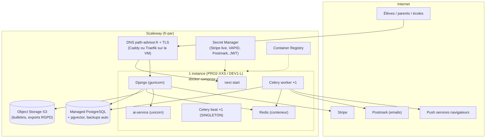

# Story (proposition) — Déploiement production de Path-Advisor

> Statut : **proposition à valider** (hors plan initial — candidate « epic 11 » ou story
> autonome). Rédigée le 27/09/2026. Les prix sont des ordres de grandeur à
> revérifier sur les grilles publiques au moment de provisionner.

## 1. Contexte et contrainte dominante

Path-Advisor sert des **mineurs** et traite des données personnelles
sensibles au sens usage (vœux d'orientation, bulletins) — pas des données de
santé (pas d'exigence HDS), mais un dossier CNIL/DPO exigeant. La contrainte
dominante du choix d'hébergeur n'est donc **pas la puissance, c'est la
posture RGPD** : résidence des données en UE, et idéalement un fournisseur
**non soumis au CLOUD Act américain** pour éviter toute la discussion
Schrems II dans le dossier DPO.

Second facteur : **solo founder**. La stack est un docker compose (Next,
Django, Postgres+pgvector, Redis, 2 workers Celery + beat, FastAPI
ai-service, stockage S3-compatible) — elle tient sur une machine modeste, et
chaque service managé en plus est de l'ops en moins.

## 2. Comparatif

| Critère | **Scaleway** (reco) | OVHcloud / Clever Cloud | AWS | GCP |
|---|---|---|---|---|
| Juridiction | 🇫🇷 française — hors CLOUD Act | 🇫🇷 françaises | 🇺🇸 (SCC + région UE requis) | 🇺🇸 (idem) |
| Dossier DPO pour une app de mineurs | Simple (DPA FR, données à Paris) | Simple | Plus lourd (Schrems II à documenter) | Plus lourd |
| Postgres managé + **pgvector** | Oui (extension supportée — à cocher au provisioning) | OVH oui / Clever oui | RDS oui | Cloud SQL oui |
| Stockage S3-compatible | Object Storage (API S3 → le code `django-storages`/boto3 marche tel quel) | OVH oui / Clever Cellar | S3 natif | GCS (interop S3) |
| Gestion des secrets | Secret Manager (— **déjà cité dans les commentaires du code**, `settings/base.py`) | variable | Secrets Manager | Secret Manager |
| Coût MVP (1 VM + PG managé + S3) | **~50-90 €/mois** | similaire | ~1,5-2× à périmètre égal | ~1,5-2× |
| Complexité pour un solo | Faible (console simple) | Faible-moyenne | Élevée (IAM/VPC/pricing) | Élevée |
| Trace dans le projet | **Le PRD et les commentaires du code l'évoquent déjà** | non | non | non |

**Pourquoi pas AWS/GCP** : rien d'infranchissable — régions UE + clauses
contractuelles types font l'affaire juridiquement — mais pour ce projet ils
n'apportent rien que la stack utilise (pas de service exotique requis), ils
coûtent plus cher au même périmètre, leur courbe IAM/réseau consomme du temps
de solo founder, et ils ajoutent un chapitre Schrems II au dossier DPO d'une
app de mineurs. À réévaluer si un besoin spécifique apparaît (GPU pour les
embeddings de l'étape 1 ML : Scaleway en loue aussi).

**Alternative crédible si tu veux encore moins d'ops** : Clever Cloud (PaaS
français, git-push-to-deploy, Postgres/Redis managés) — tu abandonnes le
contrôle docker compose contre zéro administration système. Je reste sur
Scaleway pour garder la parité dev/prod (même compose) et parce que le code
y fait déjà référence.

## 3. Architecture cible (MVP raisonnable)

### 3bis. Et le compute managé ? (Serverless Containers / Kapsule)

Scaleway peut aussi manager le **compute** — la question légitime est donc :
pourquoi une VM ? Voici le mapping complet et l'arbitrage.

| Brique compose | Option A — VM compose (reco MVP) | Option B — tout managé Scaleway |
|---|---|---|
| Next (`web`) | conteneur sur la VM | Serverless Containers (HTTP, autoscale, min-scale 1 pour éviter le cold start sur le LCP) |
| Django (`api`) | conteneur | Serverless Containers (min-scale 1) |
| ai-service | conteneur | Serverless Containers (scale-to-zero OK — appelé par l'API seulement) |
| Celery **worker** | conteneur | Serverless **Jobs** ou conteneur min=1 (un worker n'est pas du HTTP : il consomme Redis en continu → conteneur permanent, pas du serverless au sens strict) |
| Celery **beat** | conteneur ×1 | conteneur min=1/max=1 (le singleton doit être garanti — jamais d'autoscale ici) |
| Redis | conteneur sur la VM | **Managed Database for Redis®** (poste supplémentaire, ~×2-3 le coût de la VM à lui seul en petit tier) |
| Postgres / S3 / secrets / registry | **déjà managés dans les deux options** | idem |

**Arbitrage** :

- L'option B supprime l'administration de la VM (patching, firewall) et donne
  l'autoscale HTTP. En échange : **5-6 ressources facturées et configurées
  séparément** au lieu d'un compose, un Redis managé qui coûte plus que la VM
  entière, des cold starts à gérer (LCP !), la perte de la parité dev/prod
  (le compose de dev ne décrit plus la prod), et des subtilités réelles pour
  Celery (worker = process long, pas une fonction ; beat = singleton strict).
- Estimation option B : **~90-180 €/mois** (3 containers min-scale 1 + Redis
  managé + PG managé) contre 55-110 € pour l'option A — pour un trafic MVP
  qui tient sur une petite VM.
- **Verdict maintenu : option A au lancement** — le managé partout où l'état
  vit (données, secrets, backups), une VM là où seul du compute sans état
  tourne. **Déclencheurs documentés pour basculer vers B** : trafic qui
  sature la VM, besoin d'autoscale réel, ou lassitude du patching — la
  migration est incrémentale (sortir `web`/`api` vers Serverless Containers
  d'abord, Redis managé ensuite), rien dans le code ne change, seulement
  les variables d'env et le déploiement.
- Kapsule (K8s managé, control plane gratuit) : écarté au MVP — c'est de
  l'ops K8s pour un solo founder, sans bénéfice à cette échelle.

Choix assumés (consignés) :

- **1 VM + compose**, pas de Kubernetes ni de serverless : la stack tient
  largement, la parité avec le dev est totale, et un solo founder répare un
  compose à 23 h — pas un cluster.
- **Postgres managé** (pas en conteneur) : c'est LE composant qu'on ne veut
  jamais perdre — backups automatiques, PITR, montée de version gérée.
  Cocher l'extension **pgvector** (requise par la lane RLS et l'étape 1 ML).
- **Redis en conteneur sur la VM** : c'est du broker/cache reconstructible ;
  un Redis managé se justifiera plus tard. L'outbox email (8.1) tolère déjà
  une perte de broker (rien ne se perd, tout se rejoue).
- **Un seul `beat`** : les tâches planifiées (milestones 8.3, digest 8.5,
  audit ML 9.6, rappels visio 10.4) sont idempotentes par claims, mais un
  double-beat double les tentatives — le compose prod ne scale jamais beat.
- **minio disparaît** : remplacé par Object Storage (même API S3, le code
  boto3/django-storages ne change pas — seules les variables d'env changent).
- **Mailpit disparaît** : `EMAIL_PROVIDER=postmark` (story 8.1, déjà codé).

## 4. Checklist de mise en production

### Préalables non techniques (bloquants — app de mineurs)
- [ ] **DPA Postmark** signé + mention du sous-traitant dans la page RGPD (item DPO du registre).
- [ ] Revue DPO des mentions : hébergeur (Scaleway, Paris), rétentions déjà codées (RUM 90 j, art. 22 365 j, purges 1.12).
- [ ] Arbitrage DPO en attente : droit d'accès art. 15 vs flag « à risque » conseillère (10.1) et notes conseillère (6.8).
- [ ] Stripe : passage en clés **live** + webhook prod (`STRIPE_WEBHOOK_SECRET`).

### Infra
- [ ] Domaine `path-advisor.fr` + DNS chez Scaleway ; TLS auto (Caddy le fait seul).
- [ ] Instance (commencer PRO2-XXS ou DEV1-L, ~15-40 €/mois) durcie : SSH par clé, firewall (80/443 seulement), fail2ban, mises à jour auto.
- [ ] Managed PostgreSQL (DB-DEV-S pour démarrer, ~25-50 €/mois) + **pgvector activé** + backups vérifiés (faire UNE restauration d'essai avant l'ouverture).
- [ ] Object Storage : bucket privé + politique d'accès minimale.
- [ ] Secret Manager : `POSTMARK_SERVER_TOKEN`, `STRIPE_*` live, `WEBPUSH_VAPID_*` (générer une paire PROD dédiée via `manage.py generate_vapid_keys` — jamais celle du dev), `AI_SERVICE_JWT_SECRET`, `SECRET_KEY` Django, DSN Postgres.
- [ ] `infra/docker-compose.prod.yml` (aujourd'hui `services: {}`) : écrire les services (gunicorn/uvicorn — pas runserver/next dev), healthchecks, `restart: always`, logs journalisés.

### Application (variables d'env prod)
- [ ] `DJANGO_SETTINGS_MODULE=path_advisor.settings.prod` (lecture stricte : toute variable manquante fait planter le boot — c'est voulu).
- [ ] `NEXT_PUBLIC_SITE_URL=https://path-advisor.fr`, `NEXT_PUBLIC_API_URL`, `CORS_ALLOWED_ORIGINS`, `ALLOWED_HOSTS`, cookies `Secure`.
- [ ] `VISIO_BASE_URL` : garder meet.jit.si au lancement, self-host Jitsi plus tard (le PRD le prévoit).
- [ ] **Le push web exige HTTPS** — il ne marchera qu'en prod avec le domaine TLS (jamais testable en vrai sur localhost hors mode dev navigateur).
- [ ] Migrations sur la base prod + `seed_professions`/`seed_schools` (le référentiel éditorial 9.1/9.2 prend le relais ensuite).
- [ ] Créer le path_admin réel (MFA obligatoire — le flux marche pour de vrai depuis le fix 10.1).

### CI/CD
- [ ] Job `deploy` sur push `main` (après les 5 checks) : build images → push registry → `docker compose pull && up -d` sur la VM (SSH) → migrations → smoke test `/api/v1/health` (ou équivalent).
- [ ] Rollback documenté : re-taguer l'image précédente + `up -d` (les migrations étant additives par convention du projet).

### Observabilité & jour 2
- [ ] Sentry (le SDK est déjà en dépendance) : DSN prod, alertes erreurs.
- [ ] Uptime check externe (UptimeRobot ou équivalent) sur `/` et l'API.
- [ ] Vérifier après 48 h : les beats tournent (milestones/digest/audit/rappels), l'outbox est vide, **les premières lignes RUM de terrain arrivent** — ce qui ré-arme le recalibrage 8.9-AC5 (re-dû à prod + 2-4 semaines).
- [ ] Vérifs manuelles du registre : un vrai push reçu sur téléphone, une visio Jitsi à deux.

## 5. Coûts (ordres de grandeur mensuels, à revérifier)

| Poste | Estimation |
|---|---|
| Instance (PRO2-XXS/DEV1-L) | 15-40 € |
| Managed PostgreSQL (dev tier, sans HA) | 25-50 € |
| Object Storage + registry + DNS | 2-5 € |
| Postmark (10k emails/mois) | ~13 € (13-15 $) |
| Domaine | ~1 € |
| **Total MVP** | **≈ 55-110 €/mois** |

Montées en charge prévisibles : HA Postgres (×2 le poste DB), un 2ᵉ worker,
puis séparation web/API sur deux instances — rien qui casse l'architecture.

## 6. Risques et mitigations

| Risque | Mitigation |
|---|---|
| VM unique = SPOF | Accepté en MVP ; backups PG managés + compose reconstructible en < 1 h (runbook) ; HA plus tard |
| Beat dupliqué lors d'un déploiement | `docker compose up` remplace le conteneur (pas d'overlap long) ; les claims 8.3/10.4 protègent l'exactly-once |
| Secrets qui fuient dans les logs CI | Secret Manager + variables masquées GitHub Actions ; jamais de secret en clair dans compose |
| pgvector absent du tier managé choisi | Vérifier À LA CRÉATION de l'instance (sinon : instance PG self-host en repli, moins bien) |
| meet.jit.si public au lancement | Acceptable (transit only, room non devinable) ; self-host = amélioration consignée |
